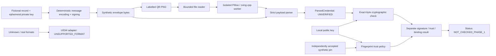

# Phase 1 technical design

## Problem and research scope

Let `c` be a presented credential, `M(c)` its exact signed message, `σ(c)` its signature,
and `pk` a candidate verification key. Phase 1 separates:

\[
V(c,pk)=\operatorname{Verify}(pk,M(c),\sigma(c)),\qquad T(pk)=\text{local trust decision}.
\]

`V = true` and `T = true` establish that a trusted key signed the covered bytes under
the selected protocol. They do not establish that the presenter is the subject or that
the credential remains current. Signature verification is a property of fixed bytes
and a key; a later database change does not alter those bytes.

For identity-level status checking, a later system needs a justified function `B(c)`
that maps every supported credential for identity `i` to the correct issuer status
handle, or to an issuer-authenticated artefact record with a documented identity
mapping. A direct stable handle would require:

\[
c_1,c_2\in\operatorname{Credentials}(i) \Longrightarrow B(c_1)=B(c_2),
\]

and distinct identities must not be conflated by the binding rule. An artefact registry
can instead map many issued handles to one identity, but the issuer must maintain and
authenticate that relationship. Neither construction has been established for unchanged
legacy Secure QR by the collected evidence.

Later status evidence would have its own signature, epoch, expiry/freshness policy, and
privacy model. This phase implements no status lookup or caching mechanism. It contains
no status lists, accumulator arithmetic, Merkle trees, Android code, P2 audit engine,
or P3 freshness evaluation.

## Assumptions

- Inputs and candidate public keys can be attacker-controlled.
- The local Python environment, filesystem permissions, and installed dependencies are
  under the researcher's control. A malicious operating system is out of scope.
- RSA-PSS/SHA-256 and library randomness are assumed secure under their standard uses.
- The caller's explicitly accepted synthetic fingerprint is an external policy input;
  the verifier does not bootstrap trust from credential contents.
- Python 3.12/macOS is the measured platform. Other platforms require validation.
- No real resident data is needed. The synthetic name grammar is deliberately narrow.
- The CLI never establishes UIDAI issuance, real identity, or current Aadhaar status.

## Architecture and data flow



The verifier's public envelope API parses internally, so externally constructed model
metadata cannot trick it into treating an unsigned ID as signed. The parser preserves
the original message bytes. It checks that those bytes follow the deterministic
synthetic encoding; it does not replace them with a new serialization for verification.

```mermaid
sequenceDiagram
    participant Issuer as Synthetic issuer
    participant Reader as QR reader
    participant Parser as Payload parser
    participant Verifier as Signature verifier
    participant Policy as Local trust policy
    Issuer->>Issuer: Generate ephemeral RSA key and UUID
    Issuer->>Issuer: Encode record, sign exact bytes
    Issuer->>Reader: Labelled QR containing envelope
    Reader->>Reader: Bound file / dimensions; decode in worker
    Reader->>Parser: Original envelope bytes
    Parser->>Parser: Check schema, algorithm and canonical encoding
    Parser->>Verifier: Original message bytes + signature
    Verifier->>Verifier: RSA-PSS / SHA-256 verification
    Policy->>Policy: Compare supplied public key against accepted pin
    Verifier-->>Reader: VALID / INVALID
    Policy-->>Reader: TRUSTED_SYNTHETIC / UNTRUSTED
    Reader-->>Reader: Report credential-only binding and unchecked status
```

## Synthetic wire protocol, version 1

The complete QR message is an ASCII JSON object with exactly three keys:

```json
{"format":"P1QR-SYNTHETIC-1","payload":"<standard-base64-message>","signature":"<standard-base64-signature>"}
```

The placeholders above are schematic and not valid credentials. The decoded signed
message has exactly these keys:

| Field | Constraint | Meaning |
|---|---|---|
| `format` | Literal `P1QR-SYNTHETIC-1` | Signed domain/version separation |
| `issuer` | Literal `SYNTHETIC / NOT UIDAI` | Explicit research label, not a trust anchor |
| `algorithm` | Literal `RSA-PSS-SHA256-MGF1SHA256-SALT32` | Signed algorithm commitment |
| `credential_id` | Canonical lowercase UUIDv4 string or null | Random artefact ID, not identity ID |
| `last_four` | Exactly four ASCII decimal characters | Synthetic collision demonstration |
| `fictional_name` | `Fictional Resident ` followed by A–Z | Restricted fictional field |

Serialization uses `json.dumps(sort_keys=True, separators=(",", ":"), ensure_ascii=True,
allow_nan=False).encode("ascii")`. The accepted schema has strings/null only. Key
ordering is lexical, there is no Unicode normalization, and generated values are ASCII.
This is not a claim of implementing RFC 8785 or cross-language canonical JSON generally.
There is no binary integer byte-order decision because integers are absent from this
protocol. UUIDs are textual. RSA integer encoding is delegated to the library.

Both base64 strings use the standard alphabet with required canonical padding and pad
bits. Unknown fields, duplicate keys at either JSON level, noncanonical signed JSON,
unsupported algorithms, invalid UUIDs, non-ASCII digit lookalikes, and truncated
signatures are rejected. Outer JSON whitespace/order is immaterial: it is a transport
wrapper. The inner format label prevents a mutable outer label from defining a different
signed protocol. Outer duplicate keys are still forbidden to avoid parser disagreement.

## Cryptographic workflow

1. Generate RSA-2048 with exponent 65537 in memory.
2. Encode the restricted record once to `M`.
3. Call `private_key.sign(M, PSS(MGF1(SHA256), salt_length=32), SHA256)`.
4. Wrap `M` and the 256-byte signature in standard base64.
5. Recover `M` from the envelope without alteration.
6. Call `public_key.verify(σ, M, identical_padding, SHA256)`.
7. Independently compare SHA-256 of DER SubjectPublicKeyInfo against an accepted pin.

The application does not prehash `M`; the library hashes it once for the signature
operation. PSS salt is random, while message encoding is deterministic. InvalidSignature
maps to `INVALID`. Unsupported algorithms and invalid keys produce explicit failures,
not a fallback to a different cryptographic scheme. PKCS#1 v1.5 signatures and PSS
signatures with a different salt length are tested and rejected.

The synthetic public-key loader accepts one canonical SPKI PEM RSA-2048 key with the
expected exponent. X.509 certificates, private keys, alternative RSA sizes, and EC keys
are outside this teaching protocol. This restriction is not a UIDAI requirement.

## Data models and decision semantics

`ParsedCredential` is immutable and always has `parsing_status = PARSED_UNVERIFIED`.
It holds format, issuer label, algorithm, signed bytes, signature bytes, optional
credential ID, suffix, and an unauthenticated binding-confidence label. Bytes and
identifier fields are hidden from its default representation.

`VerificationResult` has independent `signature`, `trust`, `binding`, `detail`, and
`status` fields. Status is fixed at `NOT_CHECKED_PHASE_1`; callers cannot set it through
the constructor. `accepted_synthetic` requires both signature validity and a matching
trust pin. It does not require an identifier and is not an identity/status decision.

| Signature | Trust | Identifier | Binding result |
|---|---|---|---|
| NOT_CHECKED | MISSING_KEY | Any | UNAUTHENTICATED |
| INVALID | Any supplied-key policy | Any | UNAUTHENTICATED |
| VALID | UNTRUSTED | Any | UNAUTHENTICATED |
| VALID | TRUSTED_SYNTHETIC | UUID present | SIGNED_CREDENTIAL_ONLY |
| VALID | TRUSTED_SYNTHETIC | null | IDENTIFIER_UNAVAILABLE |

A trusted key can accompany an invalid signature: trust describes the key, not the
message. A valid signature with no matching pin is mathematically valid but is not
accepted by the synthetic trust policy. Missing identity-level binding persists even
when a synthetic credential ID is signed.

## Resource bounds and errors

| Boundary | Limit / handling |
|---|---|
| Raw envelope | 8192 bytes |
| Decoded signed record | 2048 bytes |
| Signature | Exactly 256 bytes |
| JSON nesting | At most 8 levels, checked before JSON parsing |
| Public key file | 16384 bytes |
| Image file | 8 MiB |
| Image pixels | At most 4,000,000; each side at most 8192 |
| Image formats | Single-frame PNG/JPEG only |
| QR ambiguity | Exactly one detected QR; multiple symbols rejected |
| Worker lifetime | 10-second wall timeout; parent handles crashes |
| Local files | Regular files; nonblocking open and descriptor-level check |

The file reader performs a bounded read after `fstat`, so a growing file cannot evade
the byte cap. Image dimensions are checked before pixel conversion; Pillow bomb
warnings/errors become failures. Native image decoding runs in a short-lived child
process. It returns only bounded base64 payload or a code, not demographics. No image
is copied to an output directory during inspection or verification.

Deep JSON, decimal strings, compressed bytes, and XML are not treated as invitations
to guess the real format. There is no QR payload decompression or big-integer decoding.
`P1QRError` carries a code and a fixed explanation without input contents. Image-worker
exceptions are contained at the process boundary; the parent also rejects abnormal
exit, timeout, and malformed responses. The broad catch is limited to image-worker
failure handling and never converts an error to success.

The subprocess is fault containment, **not an OS security sandbox**. It does not impose
a portable hard address-space quota or prove absence of native vulnerabilities. File
and pixel limits bound ordinary processing allocations; an adversarial upload service
would additionally need OS resource controls, isolation, and decoder security review.
Python strings/keys are not securely erased from memory. These are explicit prototype
limitations, not hidden guarantees.

## Threat model

| Adversary/action | Control | Residual limitation |
|---|---|---|
| Changes signed fields or signature | RSA verification on original bytes | Key compromise can forge signatures |
| Substitutes own key and signed credential | Independent local pin required | User must establish pin provenance |
| Relabels algorithm or issuer | Signed fixed labels, strict schema | Only synthetic protocol is supported |
| Sends ambiguous JSON/base64 | Duplicate/schema/canonical checks | No general protocol interoperability claim |
| Sends giant file, nesting, image dimensions | Bounded reads, depth/pixel limits, timeout | Native exploitation is not formally excluded |
| Supplies multiple QR symbols | Refuse ambiguous images | “Exactly one” means one detected symbol |
| Replays an old valid QR | No freshness claim | Replay and liveness are not prevented |
| Copies a valid QR from somebody else | No possession/holder identity claim | A signature is not presenter authentication |
| Correlates a repeated stable identifier | Do not publish datasets or normal-log IDs | Static QR presentation is still linkable |
| Guesses demographics from their hashes | Do not use demographic hashes as identity binding | Hashing alone is not privacy protection |
| Replaces local code/dependencies/pin | Outside assumed trusted local environment | Research CLI is not a hardened endpoint |

No real PII is used in tests. Log tests use synthetic fields and adversarial canaries,
so they establish non-disclosure for those exercised paths rather than a claim that
arbitrary future code cannot leak real data.

## Real-format adapter and key lifecycle

`adapters/uidai.py` is an explicit boundary. Collected official descriptions establish
high-level Secure QR properties but do not provide this project with a validated,
versioned byte layout and conformance vectors. No compression, delimiter, integer
endianness, photo boundary, signature boundary, hash or padding scheme is guessed.
See the [evidence table](07_sources_and_assumptions.md) for individual confidence levels.

Before enabling a real adapter, require: version identification; precise transport and
signed-byte definitions; bounded parsing/decompression rules; issuer-authorized test
vectors; positive and tampered cases; trusted keys appropriate to that format; documented
rotation and certificate policy; and independent comparison with an authorized verifier.

Certificate provenance must be established outside an untrusted QR. Public-key
availability is not equivalent to trust. Encryption certificates, API-response
certificates, XML certificates, and QR certificates must not be selected interchangeably.
The download page is a source catalogue, not an implemented trust store. Expiry alone
does not answer whether a historical signature was valid at issuance; a signed issuance
time, trusted time evidence, compromise information, and policy may be needed. None of
this is implemented by the synthetic pin mechanism.

## Transition to later P1 experiments

Phase 2 can reuse bounded ingestion, exact-byte signature checks, error categories,
and measured tests. A simulated issuer may explicitly allocate a stable status handle
or a many-to-one artefact mapping, but must label that as new experimental infrastructure.
Only then can cached status representations be evaluated coherently. A faster status
data structure cannot repair an incorrect identity binding. No claim of unchanged
legacy compatibility follows from synthetic success.

