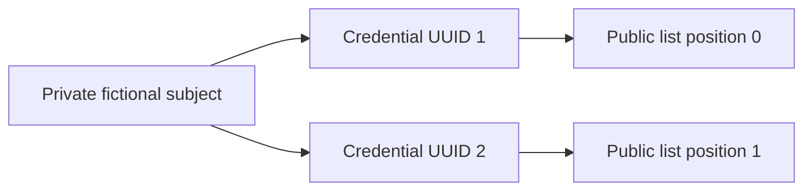

# Phase 2 beginner guide: a signed credential can later be revoked

## Start with a library-card analogy

A library gives you a card bearing its authentic seal. Later, it cancels your borrowing
permission. The seal on the old card is still genuine: cancellation did not change the
paper. A librarian needs a separate cancellation record to decide what the card means
now. If the librarian has yesterday's cancellation sheet, a cancellation made this
morning will not appear until a new sheet arrives.

In our experiment the card is a **synthetic credential**, its seal is a digital
signature, and the cancellation sheet is a **signed status snapshot**. Every example
is fictional. We do not read UIDAI lifecycle records or determine any resident's actual
Aadhaar status. Phase 1's real-format limitation remains unchanged.

Phase 2 implements **Research Bitstring Status List — Not W3C Conformant**. Established
status-list techniques motivate the work; our explicit format and tests form an
engineering baseline, not a claim to have invented revocation.

## The three identifiers you must not confuse

Imagine a private library ledger with a membership record and several issued cards:



The **internal subject ID** is used only by the simulated issuer. It identifies the
fictional membership record. The **credential UUID** identifies one issued credential.
A reissued credential gets a new UUID. The **status index** is an integer position in
a particular status list. An index is meaningful together with its list identifier.

The issuer's private ledger remembers which credentials belong to which subject.
Subject deactivation revokes every credential in that family. A public snapshot has
no subject IDs, names, photographs, or list of credential UUIDs. Its positions still
have privacy implications, explained below.

The issuer registry is deliberately in memory. Verifier caches persist, while issuer
private keys and subject mappings do not. A new default registry gets a fresh list
namespace, so index zero in a new experiment does not silently reuse index zero of
an old list. Do not manually reuse a list namespace after discarding its issuer state.

## How the credential learns its index without changing Phase 1

The Phase 1 format already signs its UUID, but contains no status-list index. We leave
that format untouched. The issuer issues a second signed document, a **binding sidecar**,
containing the credential UUID, a digest of its exact signed message, the authorized
credential-key ID, issuer/list IDs, and the assigned index.

Think of the sidecar as an additional sealed note saying, “For this exact card, use
position 7 in this cancellation sheet.” An attacker cannot simply edit 7 to 8: the
sidecar signature would fail. Pairing somebody else's note with your card also fails.

The digest is a comparison check, not a method of guessing identity or computing an
index. The private registry assigns the index. Last-four digits and demographic
similarities play no part.

The holder receives the sidecar alongside the synthetic credential and presents both.
A verifier receives trusted public-key configuration separately, before offline use.
The sidecar is not assumed to be present in an unchanged printed Aadhaar QR. Sharing
all sidecars publicly would expose UUID/index associations, so this implementation
does not create a public sidecar directory or identity registry.

## Bits, bytes, and a bitmap

A **bit** is zero or one. A **byte** contains eight bits. A **bitmap** packs many yes/no
values into bytes. Our convention is:

- 0: this assigned credential is **not revoked in this snapshot**.
- 1: this assigned credential is **revoked in this snapshot**.

Index `i` uses byte `i // 8` and the bit mask `1 << (i % 8)`. Python's `//` means whole
division, `%` means remainder, and `<<` shifts a one into the chosen bit position.

| Index | Byte | Bit within that byte | Mask |
|---|---:|---:|---|
| 0 | 0 | 0 | `00000001` |
| 7 | 0 | 7 | `10000000` |
| 8 | 1 | 0 | `00000001` |

Thus revoking indexes 0, 7, and 8 produces bytes `81 01` in hexadecimal. This is
**least-significant-bit first**, or LSB0. The bit-order declaration is signed in every
snapshot. Our detailed standard comparison is in the sources document; these bytes
must not be handed to a different standard's decoder without conversion.

If nine positions are assigned, seven remaining bits in the final byte are padding,
not seven extra valid credentials. A bound index outside the signed assigned count
returns `STATUS_INDEX_OUT_OF_RANGE`, even when its physical padding bit is zero.

## Why another signature is necessary

Without a snapshot signature, an attacker could replace a revoked bit with zero.
We sign the bitmap and the metadata together: issuer, list, epoch, issue time, expiry,
assigned count, bit ordering, algorithm, key ID, and bitmap digest. The program verifies
the exact original signed bytes.

The experiment uses three independent temporary RSA keys: one for credentials, one
for bindings, one for snapshots. An **independently accepted trust policy** authorizes
these keys for one synthetic issuer/list. A file's own key ID is not a trust anchor.
The demo can accept its own freshly generated keys because it controls their creation;
that convenience is not an issuer-discovery protocol for a real deployment.

## What an epoch and a cache do

An **epoch** is a monotonically increasing snapshot number: 1, 2, 3, and so on. It is
not a timestamp. The verifier's **cache** stores the latest acceptable snapshot and
the highest accepted epoch in one SQLite transaction. If writing is interrupted, the
program should not leave a new snapshot paired with old rollback metadata.

Once epoch 2 has been accepted, presenting epoch 1 is rejected. A different signed
message claiming epoch 2 is also rejected as a conflicting same-epoch snapshot. The
same signed message with a fresh randomized signature is harmless and idempotent.

Reopening the cache rechecks its signature, policy and stored epoch/digest relationship.
Deleted or corrupt cache data gives an explicit failure; reading never silently creates
an empty replacement. An attacker who can restore the entire trusted database to an
older copy is outside this protection. External trusted storage would be needed to
remember history independently of that database.

## Freshness is a separate question

A snapshot says when the issuer produced it and when it expires. The verifier also
sets a maximum age. To be acceptable at local time `now`:

```text
issued_at <= now < expires_at
now - issued_at <= maximum_age
```

A future-dated snapshot fails. A snapshot at its expiry instant fails. Age exactly
equal to the allowed maximum is accepted if it has not expired. These boundary rules
are tested explicitly. Signed timestamps do not supply a trustworthy clock; a manipulated
local clock remains a limitation.

The demo has a permissive three-day age policy and also shows a stricter one-day policy.
These are teaching parameters, not recommendations for banking, telecom, or government
use. No empirical thesis P3 freshness analysis is performed.

## Run the actual commands

From the project root:

```sh
uv sync --frozen --python 3.12 --extra scanner --extra dev
source .venv/bin/activate
python -m p1qr --help
python -m p1qr phase2-demo
```

The alias `python -m p1qr status-demo` runs the same experiment. The program creates
temporary synthetic material, generates and decodes a QR, and removes its temporary
directory afterward. No private key is written. Install the scanner extra: the demo
performs real image decoding and does not silently bypass it.

The output reports:

1. Day 1: `NOT_REVOKED_AS_OF_SNAPSHOT` at epoch 1.
2. Day 2: simulated subject deactivation affects both issued credentials internally.
3. Day 3: the old snapshot still gives its old answer under the permissive policy.
4. Day 3 under the strict policy: `STALE_SNAPSHOT`.
5. Day 4 after synchronization: `REVOKED` at epoch 2, while the original credential
   signature still reports `VALID`.
6. Tampered and older snapshots are rejected.

The dates are simulated using a fixed clock starting at 2026-01-01 UTC, not today's
events. No sleeping or system clock changes are needed.

To explicitly retain synthetic/public presentation files:

```sh
python -m p1qr phase2-demo --output phase2_output
```

Use a new directory. It contains the original QR/payload, binding sidecar, public keys,
two snapshots and the final verifier cache. It contains neither private keys nor the
issuer's private subject ledger. The retained cache needs the same independently accepted
trust policy if you use it later; bundled public keys are not independent provenance.

Run the checks and benchmarks:

```sh
python scripts/check_phase2.py --output docs/phase-02/results/my-verification.json
python -m p1qr benchmark-status --output phase2_benchmarks/run.json
```

The benchmark writes JSON and CSV and refuses to overwrite earlier result files.
Default populations are 10,000 through 10 million assigned bits. It does not generate
millions of fictional credentials. Read the measured report before interpreting lookup
timings: an already authenticated bit lookup is much smaller work than an entire
credential/binding/cache verification.

Phase 1 commands remain available, including `python -m p1qr demo`. Historical Phase 1
documents and its original verification report are preserved; new results live under
`docs/phase-02/results/`.

## Try the library API

This small example demonstrates cached verification without printing private subject
IDs. It uses temporary storage and keys:

```python
from pathlib import Path
from tempfile import TemporaryDirectory

from p1qr.cache.storage import SnapshotCache
from p1qr.issuer_registry.registry import IssuerRegistry
from p1qr.offline.verifier import verify_offline
from p1qr.status.trust import IssuerKeys

issuer = IssuerRegistry(IssuerKeys.generate())
subject = issuer.create_subject()
card = issuer.issue(subject)
now = 1767225600
with TemporaryDirectory() as temporary:
    cache = SnapshotCache.initialize(Path(temporary) / "cache", issuer.trust)
    snapshot = issuer.publish(issued_at=now, expires_at=now + 3600)
    cache.synchronize(snapshot, issuer.trust, now=now, max_age_seconds=3600)
    result = verify_offline(
        card.credential,
        card.binding,
        cache,
        issuer.trust,
        clock=lambda: now,
        max_age_seconds=3600,
    )
    print(result.decision.value)
```

## Privacy: what “offline” achieves

A verifier queries its local copy, so there is no per-credential network request for
the issuer to observe. That does not make presentations anonymous. The verifier sees
the presented credential and its binding, including a stable per-credential list/index.
Two verifiers can compare these. The issuer already knows the private ownership mapping
and could associate indexes with subjects if it receives observation data.

A public bitmap reveals assigned count, set bits, epochs, and update timing. Successive
lists can reveal that several positions changed together. Network delivery, if added
later, can expose downloader IP addresses and timing. There is no zero-knowledge proof,
anonymizing transport, padding/decoy policy, or protection against colluding parties here.

## Exercises and answers

1. Which bit is index 10? **Byte 1, bit 2, mask 4.**
2. A valid credential has no binding sidecar. Can the verifier use index zero? **No;
   MISSING_BINDING, with no status fallback.**
3. Subject S owns credentials at indexes 2 and 9. What does deactivation do? **It sets
   both bits to one and blocks new issuance for S.**
4. Does revoking one credential deactivate its subject? **No; our declared policy
   permits a replacement for an enabled subject using a new UUID/index.**
5. Can a Day 1 snapshot reveal a Day 2 revocation while offline? **No. It can only
   answer according to its signed state or be rejected as stale.**
6. Why isn't the result called ACTIVE? **A zero bit says nothing about later events,
   broader identity validity, or whether the presenter owns the credential.**
7. Is a complete database rollback always detectable? **No, not if every trusted copy
   of the epoch history is also rolled back.**
8. Does a 120 ns benchmark imply complete identity verification takes 120 ns? **No;
   that measurement covers a cached bit query plus loop overhead only.**

