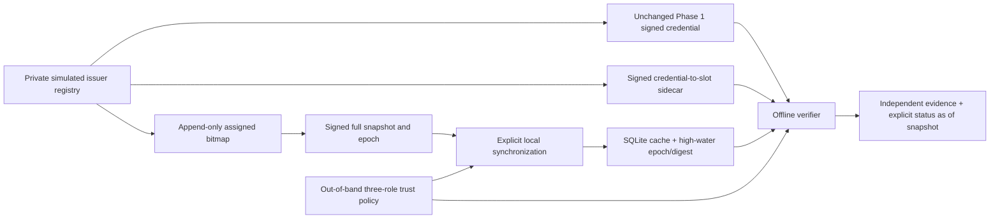
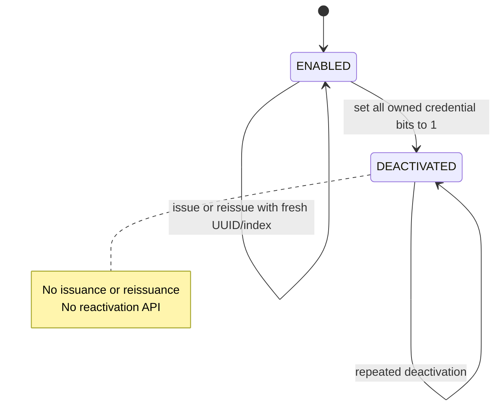

# Phase 2 technical design

## Formal objective and explicit scope

For a synthetic credential C, a signed binding A, and cached snapshot S_e, compute a
status decision while preserving separate evidence for credential signature, signer
authorization, authenticated binding, snapshot authenticity/acceptability, and status.
Let V denote signature verification and T denote independently configured role trust.
The final bit may be interpreted only when:

\[
V_C\land T_C\land V_A\land T_A\land Match(A,C)\land
V_S\land T_S\land Context(A,S)\land RollbackOK(S)\land Fresh(S,t).
\]

For authenticated index i in the assigned range:

\[
status(C,S_e)=
\begin{cases}
REVOKED & B_e[\lfloor i/8\rfloor]\ \&\ (1\ll(i\bmod8))\ne0,\\
NOT\_REVOKED\_AS\_OF\_SNAPSHOT & \text{otherwise}.
\end{cases}
\]

Failures return explicit categories, never a default zero-bit decision. No result
establishes real Aadhaar status, holder possession, current identity validity, or
unmodified legacy Secure QR compatibility. This is P1's first simulated-issuer baseline.
There is no accumulator, Android implementation, thesis P2 audit log, or empirical P3
use-case freshness study.

## Architecture



`IssuerRegistry` handles private identity ownership and lifecycle. `status_binding`
creates/verifies sidecars. `status` implements bounded signed documents, bitmaps and
snapshot validation. `cache` provides persistence. `offline` integrates the unchanged
Phase 1 verifier with the new stages. `benchmarks` measures explicitly delimited work.
`phase2_cli` registers new commands without changing Phase 1 command behavior.

## Trust model

`IssuerTrust(issuer_id, list_id, credential, binding, snapshot)` is trusted local
configuration. Each `KeyTrust` has a candidate RSA public key and an optional accepted
SHA-256 SPKI fingerprint. No pin or mismatched pin means UNTRUSTED; no key means
MISSING_KEY. All three roles use separate generated RSA-2048 keys in demonstrations.

The authorization relationship is explicit: the operator authorizes these three keys
for the same configured issuer/list. It is not discovered from a self-declared key ID,
network endpoint, certificate, or signature made by another role. A valid signature by
an unauthorized key is insufficient. Rotation/delegation/X.509 processing are not
implemented; replacing trust anchors requires explicit policy provisioning.

Assumptions: secure cryptographic primitives/RNG, trusted local code/configuration,
correct issuer registry execution, a suitable local clock, and trusted persistent
high-water storage. A malicious issuer can deliberately sign false mappings or status;
signatures cannot make those claims true. Same-epoch conflict checks detect encountered
conflicts but do not provide global issuer-equivocation detection.

## Registry model and lifecycle

Private structures contain `Subject(subject_id, state, credential_ids)` and
`RegistryEntry(credential_id, subject_id, status_index)`. Public `IssuedCredential`
contains credential bytes, sidecar bytes, credential UUID and index, never subject ID.
Internal fields use `repr=False`; debug access is explicit through `subject()` and
`entry()`. These APIs are for the issuer, not ordinary verifier output.

Allocation is dense, sequential, permanent, and scoped by list ID. Every position
`0 <= i < assigned_count` is assigned; no holes or free-list exist. The registry checks
duplicate subject UUIDs, credential UUIDs and index owners. It prepares signatures before
committing in-memory allocation. The bitmap's append API refuses gaps and reuse.



Credential bits independently transition `0 → 1` and never back. Single-credential
revocation leaves its subject ENABLED and does not revoke siblings. Reissuance gives
an enabled subject a new credential/slot and leaves the old slot unchanged. Subject
deactivation affects all siblings and blocks new issuance. This is an experimental
lifecycle policy, not a description of UIDAI suspension/death/deactivation rules.

The registry is single-process and not durable. Private keys are ephemeral. By default
each new registry generates a fresh list namespace, preventing accidental reuse across
experiments. Explicitly supplying an old list ID without restoring complete state is an
unsafe administrative action outside the intended lifecycle. Durable issuer recovery
and multi-command private-key storage are not implemented or necessary for this demo.

## Signed document encoding

Phase 1 remains `P1QR-SYNTHETIC-1` with its original 2 KiB signed-record limit. New
documents use a separate flat JSON envelope:

```json
{"payload":"<standard-base64 exact signed JSON>","signature":"<standard-base64 RSA signature>"}
```

Signed records use sorted keys, ASCII JSON, compact separators, no NaN/floats, no nested
arrays/objects, no duplicate keys, and bounded nonnegative integers. Integers are decimal
JSON values no larger than `2^53-1`; timestamps have the tighter upper bound 4102444800.
Booleans are not integers for schema validation. Base64 alphabet/padding/pad bits are
canonical. The parser compares canonical encoding but passes **original decoded signed
bytes**, not reconstructed bytes, to the cryptography library.

Signature parameters are RSA-2048/e=65537, PSS, SHA-256, MGF1-SHA256, 32-byte salt, with
the existing documented algorithm label. The algorithm and SPKI key fingerprint are
inside the signed record. PSS is randomized; comparisons of same-epoch records use a
digest of their signed messages, not their randomized signature bytes.

This is a research protocol, not JSON-LD/VC proof processing, JOSE, COSE, W3C or IETF
conformance. There is no compression or delta format. The standard comparison and
reusable concepts are recorded in [sources and assumptions](07_sources_and_assumptions.md).

## Binding assertion version 1

| Signed field | Meaning |
|---|---|
| `protocol` | Literal `P1QR-STATUS-BINDING-1` |
| `issuer_id`, `list_id` | Exact namespaces authorized by local policy |
| `credential_id` | The existing signed Phase 1 UUID |
| `credential_sha256` | SHA-256 of exact signed Phase 1 message bytes |
| `credential_key_id` | Authorized credential signing key's SPKI fingerprint |
| `status_index` | Registry-assigned nonnegative position below the capacity limit |
| `algorithm`, `key_id` | Binding signature profile and binding-role key ID |

The verifier first authenticates the credential. It then verifies the sidecar using
the separately authorized binding key and compares the UUID, message digest and
credential key. The digest makes the match unambiguous; it is not an index derivation
or demographic/identity inference. An issuer intentionally signing two inconsistent
assignments is outside a lone verifier's ability to fully audit.

Distribution uses a holder-presented sidecar delivered at issuance. The verifier must
receive it with the synthetic credential before an offline decision. It does not obtain
it by a per-person network lookup. An unchanged printed Aadhaar QR does not supply
this new artefact. Sidecars add storage and presentation requirements and reveal stable
credential/index associations to recipients. They should not be published as a global
identity mapping.

## Bitstring and snapshot version 1

Bytes are in natural increasing byte order; positions within each byte use LSB0.
The raw size for N assigned entries is `ceil(N/8)` bytes. All unused high bits in the
final byte must be zero. Count is signed, so unused padding cannot create valid entries.

| Snapshot field | Required constraint |
|---|---|
| `protocol` | `P1QR-RESEARCH-STATUS-1` |
| `issuer_id`, `list_id` | Match trusted configuration and binding |
| `epoch` | Positive bounded integer; publisher increments after successful signing |
| `issued_at`, `expires_at` | Unix seconds, `0 <= issued_at < expires_at <= 4102444800` |
| `assigned_count` | Integer 0…10,000,000; dense allocation semantics |
| `bit_order` | Literal `LSB0` |
| `bitmap` | Canonical standard base64 of exact raw bitmap |
| `bitmap_sha256` | SHA-256 of decoded bitmap, checked in addition to signature |
| `algorithm`, `key_id` | Signed profile and authorized snapshot-role key ID |

The extra bitmap digest is redundant for authenticity because the signature covers
the bitmap. It supplies a convenient consistency check and an explicit digest field;
it does not create additional issuer trust.

Limits: sidecar envelope 8192 bytes, snapshot envelope 3 MiB, signed message 2 MiB,
bitmap 1,250,000 bytes, no nested JSON, no decompression. Type/length/encoding failures
are explicit. Limits bound ordinary processing, not malicious native-library execution
or an attacker controlling the entire local process.

## Cache transaction and rollback rules

One `status.sqlite3` database serves one issuer/list/key-policy context. Its single row
stores version, policy digest, highest epoch, signed-message digest and original envelope
BLOB. Explicit initialization creates an empty epoch-zero state in a new directory.
Directory/database modes are 0700/0600 on the tested POSIX system.

Synchronization first authenticates and checks candidate freshness, then starts
`BEGIN IMMEDIATE`. It validates the existing row and its snapshot even if the old
snapshot is now stale. It applies these rules:

1. Lower epoch → SNAPSHOT_ROLLBACK.
2. Equal epoch and different signed-message digest → SNAPSHOT_EQUIVOCATION.
3. Equal epoch and identical message → idempotent acceptance.
4. Higher epoch → require nondecreasing issuer time/count and no cleared revoked bit.
5. Commit new envelope and epoch/digest in the same SQLite transaction.

Epoch gaps are allowed. A verifier can miss intermediate publications and synchronize
directly to a newer acceptable snapshot. Decreasing counts or clearing bits violates
the declared permanent-revocation model and is rejected as SNAPSHOT_REGRESSION.

Restart opens the database in `mode=rw`, never create mode. It reauthenticates the BLOB,
compares it to durable epoch/digest metadata, and applies current freshness rules.
Missing/corrupt metadata never resets to epoch zero. An older BLOB with the newer
high-water record is detected. Transaction failures leave the previous committed row;
concurrent writers cannot lower the high-water epoch. Tests include an injected SQLite
write failure and concurrent synchronizations. SQLite's guarantees still rely on its
documented filesystem/locking/durability assumptions; a physical power-loss test was
not performed. ([SQLite atomic commit](https://www.sqlite.org/atomiccommit.html))

The database itself is trusted local history. Replacing or deleting **all** history and
reinitializing it defeats the knowledge of a previous epoch. No TPM, remote witness,
independent monotonic counter, backup attestation, or global anti-equivocation service
is claimed. A corrupt cache needs deliberate recovery with trusted recent evidence,
not silent fallback to an old snapshot.

## Freshness and integrated algorithm

At one injected local time t, accept only `issued_at <= t < expires_at` and
`t - issued_at <= max_age_seconds`. There is no future-clock tolerance. A signed time
is authenticated as a statement but is not an externally trusted clock. Clock manipulation
within the interval may evade freshness checks; proving trusted time is outside this phase.

`verify_offline()` returns an immutable result with credential signature/trust, binding
signature/trust/match, snapshot signature/trust/acceptability, decision, epoch, issued-at
and expiry. Authenticated stale/future failures preserve snapshot metadata while refusing
to return a bit decision. Invalid/missing earlier stages remain NOT_CHECKED downstream.

```mermaid
sequenceDiagram
    participant I as Simulated issuer
    participant H as Fictional holder
    participant V as Offline verifier
    participant K as Durable cache
    I->>I: Create private subject; allocate fresh UUID/index
    I->>H: Signed unchanged credential + signed sidecar
    I->>V: Full signed snapshot epoch 1
    V->>K: Verify trust, signature, time; commit epoch 1
    H->>V: Present original QR + sidecar
    V->>V: Verify credential and binding under separate role keys
    V->>K: Authenticate cached snapshot and freshness
    V-->>H: NOT_REVOKED_AS_OF_SNAPSHOT, epoch 1
    I->>I: Deactivate subject; revoke all credential slots
    H->>V: Present same original QR while disconnected
    V-->>H: Epoch 1 result or STALE_SNAPSHOT per policy
    I->>V: Full signed snapshot epoch 2 on later synchronization
    V->>K: Authenticate; enforce monotonicity; atomic commit
    H->>V: Present same original QR + sidecar
    V->>V: Credential signature still VALID
    V-->>H: REVOKED according to epoch 2
```

Ordinary verification reopens and validates the snapshot each time. Thus full checking
includes O(N) snapshot parsing, whereas querying an already authenticated immutable
bitmap is O(1). Benchmarks report these separately. A future batched verifier may reuse
an authenticated snapshot, but must reapply freshness and define how it observes newer
cache epochs. A stale in-memory object must not silently bypass synchronization policy.

## Threats, achieved properties, and limits

| Threat | Implemented control | Remaining assumption/limit |
|---|---|---|
| Credential or binding modification | Exact-byte signatures; UUID/digest/key/context match | Trusted keys not compromised |
| Attacker selects a zero slot | Only authenticated sidecar supplies index; range check | Issuer correctly allocates slots |
| Malformed/oversized snapshots | Strict bounded flat JSON/base64/count checks | Not formal parser verification |
| Tampered bitmap or metadata | Complete snapshot signature and digest check | Malicious authorized issuer can lie |
| Old snapshot replay | Durable epoch/digest; atomic update | Entire trusted storage rollback is outside model |
| Same-epoch conflicts | Reject encountered conflicting message | Does not detect unseen issuer forks |
| Missed update | As-of result or stale rejection | Cannot discover unknown future events offline |
| Per-person issuer observation | No network calls/fallbacks in verification | Future transport metadata and collusion remain |
| Public identity registry | Subject mappings withheld from public snapshots | Index/count/change patterns still leak |
| QR copying / presenter impersonation | No false claim of holder possession | No liveness/session binding |

The current implementation provides no secret membership proof, anonymity, unlinkability
against collusion, production key storage, automated issuer discovery, or long-lived
issuer-state recovery. These boundaries must accompany any thesis performance claim.

